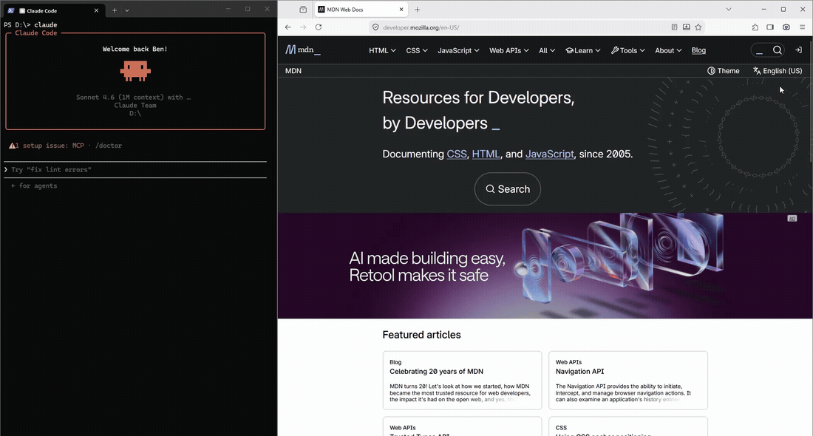

<p align="center">
  
</p>

<p align="center">
  <a href="https://github.com/bgaze/snapstack-server/actions/workflows/ci.yml"></a>
  <a href="LICENSE"></a>
  = 18">
  <a href="https://modelcontextprotocol.io"></a>
  
  <a href="https://www.npmjs.com/package/snapstack-server"></a>
  <a href="https://www.npmjs.com/package/snapstack-server"></a>
  <a href="https://glama.ai/mcp/servers/bgaze/snapstack-server"></a>
</p>

<p align="center">
  
</p>

The **SnapStack server** is a single always-on Node process: it receives browser captures from the
[extension](https://github.com/bgaze/snapstack-extension) — and, if you opt in, the screenshots your OS screenshot tool
saves to a folder — stacks them on disk, and serves them to any MCP-capable LLM client over **Streamable HTTP**. It listens only on `127.0.0.1` — nothing ever leaves your machine.

> **New here?** The full install + usage guide lives in the **extension README**:
> **[snapstack-extension](https://github.com/bgaze/snapstack-extension)**. This page is the technical reference.

## Architecture

One always-on process serves both the extension (capture) and your MCP client, decoupled by a folder on disk.

```
[MV3 extension]  --POST /push (bytes) ┐
[watched folder] --new screenshot ────┤   (opt-in: snapstack watch)
                                      ▼
                              [SnapStack server - 127.0.0.1:4123]   
                                 ├─ writes           →  stack on disk
                                 └─ MCP /mcp (HTTP)  ←  MCP client
```

- **Capture** — the extension encodes the shot as WebP (PNG fallback), downscales it, and POSTs it here.
- **Watched folder** *(opt-in)* — screenshots saved by the OS tool (macOS Cmd+Shift+3/4/5, Windows Win+PrtScn /
  Snipping Tool, GNOME, KDE Spectacle) are converted the same way and stacked. See
  [Screenshots from the OS tool](#screenshots-from-the-os-tool-watched-folder).
- **Stack** — one image file (`.webp`/`.png`) plus a twin `.json` (url, title, timestamp, dimensions) per capture,
  named `NN <timestamp>`: a stable two-digit **number** (assigned in capture order, restarts at `01` when the stack
  empties) plus a timestamp, under `~/.snapstack/`.
- **Retrieval** — `get_screenshots` returns a JSON **manifest** (number, absolute path, dimensions, metadata —
  *no image bytes*); the client reads only the files it needs, by path. Deletion is a separate, explicit
  `clear_screenshots` step. **Retrieval never deletes.**

## Requirements

- **Node.js ≥ 18** (tested on Node 18 to 24). No git needed at runtime, no native addon (image conversion is WASM).
- An **MCP-capable LLM client** speaking the **HTTP** (Streamable HTTP) or **stdio** transport.
- The **[snapstack-extension](https://github.com/bgaze/snapstack-extension)** loaded in your browser, and/or a
  [watched screenshots folder](#screenshots-from-the-os-tool-watched-folder).

## Install & run

> On Windows, **use an Administrator terminal**, otherwise the global npm install and the scheduled-task registration
> may get rejected.

The server ships on npm and installation is straightforward on macOS, Linux and Windows:

1. Install globally: `npm i -g snapstack-server`
2. Enable background service: `snapstack enable`

SnapStack auto-starts on login, restarts on crash, and updates itself on each launch.  
To check its status or if an update is available, simply run `snapstack` in your terminal.

Available commands:

```bash
snapstack                            # status report: service + server health, update check
snapstack start | stop | restart     # control the running service (this session)
snapstack update                     # update the CLI (npm i -g) + restart the server on the latest
snapstack watch [folder | off]       # send the OS screenshot tool's captures to the stack (guided when bare)
snapstack run                        # run the daemon in the foreground (no auto-start)
```

The **daemon** self-updates on each (re)start/login; the **global CLI** (the `snapstack` command) does not.
Run `snapstack update` to bring **both** to the latest in one go.

The full end-to-end walkthrough (idiomatic install paths, MCP client registration, the extension) is in the
**[extension README](https://github.com/bgaze/snapstack-extension)**.

## Screenshots from the OS tool (watched folder)

Off by default (server 1.3.0+ — run `snapstack update` first if you installed an earlier version). Once enabled, the
server watches **one folder**: every new image saved there (by the OS screenshot
tool, or anything else) is downscaled and encoded with the [capture policy](#capture-policy-shared-across-your-browsers)
— exactly like an extension capture — and added to the stack, where your MCP client reads it. Its `title` is the
original file name, its `url` is `null`.

```bash
snapstack watch                                  # guided setup (in a terminal)
snapstack watch ~/Pictures/Screenshots           # watch this folder (keeps the originals)
snapstack watch ~/Pictures/Screenshots --delete-original
snapstack watch off                              # stop watching
snapstack                                        # the "Watch folder" row shows the live state
```

The **guided setup** proposes the right folder for your OS, creates it, checks that the **background service** can
actually read it, and finally offers a live test (take a screenshot, see it land in the stack). On macOS it can also
point the screenshot tool at that folder and turn off the floating thumbnail that delays every save — each only after
you say yes, showing the command to undo it. Run again while a
folder is watched, it first offers to stop watching; answer no to change the current setup.

- **Which folder.** macOS: the `com.apple.screencapture` `location`, else the Desktop. Windows: the *Screenshots*
  folder (Win+PrtScn; Snipping Tool auto-save). Linux: `Pictures/Screenshots` (GNOME; KDE Spectacle is configurable).
- **macOS may keep background services out of the Desktop, Documents and Downloads** (privacy protection — it depends
  on what was granted on your Mac; the setup checks it for real). The safe choice is another folder (the setup proposes
  `~/Pictures/Screenshots`), with macOS pointed at it:
  `defaults write com.apple.screencapture location ~/Pictures/Screenshots`, or Cmd+Shift+5 → Options → Other Location.
- **macOS floating thumbnail:** macOS writes a screenshot only once its thumbnail goes away (~5 s). For an immediate
  arrival in the stack, turn it off: Cmd+Shift+5 → Options → uncheck *Show Floating Thumbnail*, or
  `defaults write com.apple.screencapture show-thumbnail -bool false`. The setup offers to do it (after an explicit
  yes, showing the undo command).
- **What is picked up:** new image files only (`png`, `jpg`, `gif`, `webp`, up to 50 MB). Files already present when
  you enable the watch, hidden files (macOS writes `.Capture…` first), videos and sub-folders are ignored. An image
  that cannot be converted is stacked as-is, and its original is always kept.
- **Originals** are kept by default; with `--delete-original` they are deleted once safely in the stack.
- **No restart needed:** the server picks a new setting up within a second. The setting can only be changed from the
  command line — it is never exposed over HTTP, so no web page or extension can make the server read another folder.
- **Files:** the setting lives in `~/.snapstack/watch.json` (written by the CLI), the server's verdict in
  `~/.snapstack/watch-state.json` (written by the server). A stack clear never touches them.

## MCP

SnapStack speaks two MCP transports over the same on-disk stack — pick whichever your client supports:

```jsonc
// HTTP (server already running) — register http://127.0.0.1:4123/mcp; copy deploy/mcp.json
{ "type": "http", "url": "http://127.0.0.1:4123/mcp" }
```

```jsonc
// stdio (the client spawns the process)
{ "command": "npx", "args": ["-y", "-p", "snapstack-server", "snapstack", "mcp"] }
```

The HTTP `/mcp` endpoint is **stateless** (a fresh server + transport per request); the stdio front-end
(`snapstack mcp`) is spawned on demand and reads the same `~/.snapstack` stack.  
Capture intake (`/push`) always stays in the running server, independent of either MCP front-end.

### Exposed tools

| Tool                | Description                                                                                                                                                                         |
|---------------------|-------------------------------------------------------------------------------------------------------------------------------------------------------------------------------------|
| `get_screenshots`   | Lists pending captures as a JSON manifest (stable number, absolute path, dimensions, metadata) — **no image bytes, no deletion**. Pass `numbers` (e.g. `[1,3]`) to list only those. |
| `clear_screenshots` | Deletes captures. Pass `numbers` to delete specific ones; omit to clear the whole stack. Numbering restarts at `01` once empty.                                                     |
| `count_screenshots` | Number of pending captures, without retrieving them.                                                                                                                                |

`get_screenshots` and `count_screenshots` are **read-only**; only `clear_screenshots` is **destructive**. 

## Configuration

### Environment variables (infrastructure)

| Variable         | Default        | Purpose                                 |
|------------------|----------------|-----------------------------------------|
| `SNAPSTACK_DIR`  | `~/.snapstack` | Stack folder.                           |
| `SNAPSTACK_PORT` | `4123`         | Listening port (always on `127.0.0.1`). |

### Capture policy (shared across your browsers)

The encoding/capture settings are **owned by the server** and stored in `~/.snapstack/config.json`, so a single
edit applies to **every browser** running the extension. They are edited from the extension's **options page** — not
an environment variable — and fetched by the extension before each capture.

| Key         | Default | Meaning                                                                   |
|-------------|---------|---------------------------------------------------------------------------|
| `format`    | `webp`  | Image format: `webp`, `png` or `jpg`.                                     |
| `quality`   | `0.85`  | Lossy quality (`0`–`1`; the extension UI shows it as a percentage).       |
| `maxWidth`  | `1568`  | Downscale captures wider than this to this width in px (`0` = no resize). |
| `maxSlices` | `50`    | Full-page capture: hard cap on stitched slices.                           |

Two endpoints back it: `GET /config` returns the effective policy; `POST /config` validates and replaces it (host- +
CORS-guarded like every capture route). The file is a non-image, so a stack clear never touches it; deleting it just
restores the defaults above.

## Troubleshooting

- **Capture server not started message in the extension:** run `snapstack start` (or `snapstack run` in the foreground),
  or check the auto-start with `snapstack`. Test: `curl http://127.0.0.1:4123/health`.
- **Port already in use (`EADDRINUSE`):** set `SNAPSTACK_PORT` to another value.
- **`snapstack: command not found` after switching Node version** (nvm, fnm, volta, Laravel Herd, nvm-windows): `npm i -g`
  drops the `snapstack` command in the global bin of the Node version that was active at install time only, so switching
  versions hides it. This is how npm globals work, not a SnapStack bug — the **background service is unaffected and keeps
  capturing**; only the CLI command disappears. Fix: re-run `npm i -g snapstack-server` under the current Node version (or
  switch back to the one used at install).
- **The client doesn't see the tools:** the server must run **before** the MCP client starts; check the config
  (`type: "http"`, correct URL). Direct test: `curl http://127.0.0.1:4123/count`.
- **Watch folder in `error` (macOS: "not allowed to read this folder"):** the folder is under the Desktop, Documents or
  Downloads, which macOS keeps away from this background service. Run `snapstack watch` and pick another folder.
- **Screenshots do not reach the stack:** check `snapstack` (the *Watch folder* row must say `watching`), then that
  the OS tool really saves there — on macOS, a `location` pointing at a missing folder silently falls back to the
  Desktop (`defaults read com.apple.screencapture location`).
- **Inspect the stack:** `ls ~/.snapstack` (image files + human-readable `.json`).

## Support

- **A question or an idea?** → [GitHub Discussions](https://github.com/bgaze/snapstack-server/discussions)
- **Found a bug?** → [open an issue](https://github.com/bgaze/snapstack-server/issues)

## License

MIT — see [LICENSE](./LICENSE).
